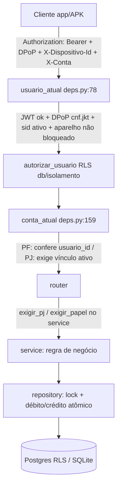

# 02 — Avaliação técnica

> Revisão read-only no commit `289effb`. Áreas de autorização, finanças e identidade **verificadas no
> código**; demais dimensões **não verificadas** (N/V) — pendentes das ondas que caíram por limite de uso.

## Fluxo de uma requisição autenticada (rotas reais)

## Fluxo financeiro (transferência) — checagens verificadas
Ordem (`pagamento_service.py:8-20`): destino≠origem + papel + aparelho → alçada (por operação, diária
reconferida **dentro do lock**, assinatura conjunta por porte) → MFA facial acima de `LIMITE_FACIAL_REAIS`
→ bloqueio cautelar p/ destino novo → saldo + limites **dentro do lock** junto ao débito. Idempotência
escopada por carteira (`:49-50`). Transferência **não** aciona split.

## Camadas de segurança presentes (fato)
DPoP (`core/dpop.py`, `dpop_jtis`), atestação de aparelho (`core/atestacao.py`), cifragem de PII
(`core/dados_pessoais.py`, `db/dados_cifrados.py`), isolamento/RLS (`db/isolamento.py`,
`seguranca_runtime.py`, papéis `astro_app`/`astro_migrator`), validação de boot fail-closed em produção
(`core/config.py:_conferir_producao` — exige TLS verify-full no banco, CORS/DPoP HTTPS, segredos).

## Pontuação por dimensão (0–5; N/V = não verificado, não é zero)

| Dimensão | Nota | Base (evidência / motivo) |
|---|---|---|
| Arquitetura | 4 | Camadas claras router→service→repository→db; gate de papel no service (ASTRO-001, P3) |
| Integridade financeira | 4 | Lock + idempotência + split condicionado + maker-checker (`pagamento_service`, F-04/05/06/07); concorrência real a validar em teste executado |
| Identidade/permissões | 4 | `conta_atual` posse+vínculo, invariante ≥1 admin, convite por CPF (F-01/07/08) |
| Segurança (AppSec) | 4 | DPoP, RLS, admin fail-closed, idempotência anti-forja (F-02/03/04/09); IDOR amostral refutado; **falta** varrer todas as rotas `{id}` e teste adversarial |
| Regras fiscais / transparência | **N/V** | Site/promessas e split-2026 não auditados (pendente `10`) |
| UX PF | **N/V** | Jornadas não percorridas (pendente `03`) |
| UX PJ/MEI | **N/V** | Pendente |
| UX PJ/PME-Grande | **N/V** | Pendente |
| Design system / responsivo | **N/V** | Pendente (`05`) |
| Acessibilidade / QA | **N/V** | 448 testes contados, não executados; WCAG não avaliado |
| Confiabilidade / entrega (SRE) | **N/V** | CI/infra não auditados nesta fase |
| Consistência demo↔backend | 3 (parcial) | Front tem modo mock (`http.ts`) e modo API; paridade de regras mock×backend não verificada a fundo |

## Conclusão técnica (sem média mascarada)
**Força principal:** autorização, posse e integridade financeira sólidas e já endurecidas, com defesas
acima do esperado para protótipo acadêmico; nenhum P0/P1 nas áreas verificadas. **Risco principal
residual:** garantir, por teste, que **todas** as rotas por id e de escrita PJ têm cobertura negativa de
autorização (ASTRO-002). **Maior lacuna:** dimensões de produto/UX/regulatório/SRE e biometria adversarial
**ainda não auditadas** — não convertê-las em nota nem em aprovação.
