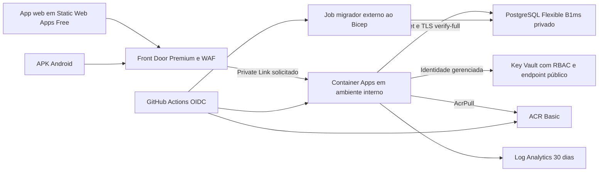

# Análise crítica da arquitetura Azure — ASTRO (escopo acadêmico)

Data: 12/10/2026. Repositório: `alefkaue/payment-platform`. Base analisada: `80d3aa9`, após integrar 15 commits remotos por fast-forward. A revisão não modificou a aplicação nem implantou recursos.

## 1. Parecer

O desenho é coerente para uma aplicação de pagamentos em evolução: monólito modular FastAPI, PostgreSQL como núcleo transacional, frontend estático, identidade gerenciada e borda protegida. Existe segurança implementada no código, não apenas caixas em um diagrama.

**O critério desta revisão é uma aplicação acadêmica funcional e segura, com dinheiro simulado.** Depósitos fictícios, ausência de integração bancária real e RG sem autenticação externa são simplificações aceitas pelo autor do projeto. Não constituem falhas nem bloqueios da entrega. `AMBIENTE=producao` pode representar o runtime publicado e seus controles técnicos, sem significar que o produto opera dinheiro real.

Transferências, autenticação facial, autorização, persistência e proteção dos dados precisam funcionar de verdade. A base tem controles relevantes implementados, mas esta revisão ainda não comprova o funcionamento ponta a ponta no Azure nem a qualidade da facial real. A entrega deve priorizar essas provas, o deploy reproduzível e a prevenção de acesso indevido; alta disponibilidade bancária e recuperação regional ficam como evolução opcional.

Este parecer foi ajustado ao esclarecimento do autor em 12/10/2026. As evidências técnicas e os resultados de testes da análise original foram preservados; não houve nova execução da aplicação nesta revisão do documento.

### Contrato do trabalho

| Funcionalidade | Expectativa para a entrega |
|---|---|
| Depósito | Pode criar saldo fictício no servidor; deve ficar identificado como simulação e respeitar limites e autorização |
| Pix/boleto/cartão/repasse fiscal externos | Podem ser simulados; não é necessário conectar bancos ou movimentar reais |
| RG e autenticidade documental | Podem ser simplificados ou dispensados; não exigir consulta oficial ou KYC bancário |
| Transferência entre contas | Deve debitar/creditar saldo persistido corretamente, com autorização, idempotência, histórico e proteção contra gasto concorrente |
| Reconhecimento facial | Deve usar câmera e motor real no ambiente apresentado; verificar correspondência e comportamento de prova de vida, sem aprovação automática por stub |
| Login e contas PF/PJ | Devem validar sessão e vínculo; alterar `X-Conta` não pode dar acesso a outro titular |
| Azure e dados | Segredos protegidos, TLS, acesso mínimo e implantação funcional; fotos/templates reais continuam merecendo proteção mesmo com saldo fictício |

Não se exige certificação biométrica bancária, escala de banco comercial, liquidação externa, HA multizona ou operação 24/7. Uma interface que apenas altera dados de mock não comprova transferência real dentro da aplicação.

Esta é uma revisão real do código e da configuração versionada, com execução de testes selecionados. Não é uma auditoria de uma assinatura Azure: não havia Azure CLI/Bicep disponível no PATH nem acesso autenticado à assinatura. Não foram verificados recursos efetivos, faturamento, DNS, RBAC implantado, branch protection, logs de produção ou disponibilidade real. Ausência de configuração no repositório significa ausência de evidência versionada, não prova de que um operador nunca a configurou manualmente.

## 2. O que foi analisado

| Área | Evidência principal | O que foi conferido |
|---|---|---|
| Infraestrutura | `infra/azure/main.bicep` | Rede, Postgres, ACA, Front Door, WAF, ACR, Key Vault, identidades, segredos, probes e escala |
| Entrega | `.github/workflows/azure.yml`, `backend.yml`, `android.yml` | Gatilhos, OIDC, build, migração, publicação web, relação entre validação e deploy |
| Operação | `docs/operacao/AZURE.md`, `KEY-VAULT-PRIVATE-ENDPOINT.md`, `docs/arquitetura/BANCO.md` | Bootstrap, papéis, Private Link, rotação, restauração e diferenças entre instruções e código |
| Runtime | `backend/Dockerfile`, `entrypoint.sh`, `app/main.py`, `core/config.py`, `core/perimetro.py` | Usuário, modelos, modo produção/demo, limites HTTP, saúde e inicialização |
| Identidade | `app/deps.py`, `core/dpop.py`, `core/atestacao.py` | IP de origem, conta selecionada, DPoP, confiança de proxy, administração e assinatura do APK |
| Dados | `db/base.py`, `isolamento.py`, `seguranca_runtime.py`, `permissoes.py`, `dados_cifrados.py`, migrações | Pool, timeouts, RLS, privilégios, criptografia e validação no boot |
| Financeiro e integração | `repositories/repository.py`, serviços de pagamento e webhook, `routers/admin.py` | Locks, idempotência, outbox, reenvio e jobs necessários |
| Frontend | `app/scripts/cabecalhos.mjs`, `app/src/lib/http.ts`, `api.ts` | CSP, URL de produção e integração com a API |
| Testes | Sete arquivos de teste existentes | Configuração de produção, perímetro, criptografia, DPoP, outbox e estado de entrega |

A documentação histórica foi usada como contexto; o código da base acima decide o diagnóstico. Achados de versões antigas não foram reapresentados como se continuassem abertos.

## 3. Arquitetura efetivamente declarada



O ambiente ACA está com `internal: true` e `publicNetworkAccess: 'Disabled'`; a origem do Front Door usa `sharedPrivateLinkResource`. O `ingress.external: true` da aplicação permite exposição no ambiente ACA e não contradiz, sozinho, o ambiente interno. **Não há evidência estática de origem pública contornando o WAF nesta versão.** Confirmar isso exige aprovar a conexão privada e testar acesso direto após implantação. O padrão é documentado pela [Microsoft para ACA e Front Door Premium](https://learn.microsoft.com/en-us/azure/container-apps/front-door-custom-virtual-network-private-link).

O Key Vault é diferente: não tem Private Endpoint nem bloqueio explícito de rede pública no Bicep. A proposta em `KEY-VAULT-PRIVATE-ENDPOINT.md` não foi aplicada. O ACR Basic também não declara isolamento privado; autenticação continua sendo exigida.

## 4. O que está bom e deve ser preservado

1. **PostgreSQL privado e TLS verificado.** Sub-rede delegada, DNS privado e `verify-full` com CA configurada evitam depender só de senha ou de TLS sem validação do servidor. A cadeia real de certificados ainda precisa ser validada no Azure.
2. **Identidade gerenciada com escopos específicos.** A API tem `AcrPull` no registro e `Key Vault Secrets User` no cofre. O admin do ACR está desligado. O pipeline usa OIDC em vez de uma senha Azure permanente no GitHub.
3. **API separada do migrador.** `RUN_MIGRATIONS=0`, auditoria de privilégios efetivos e política explícita de tabelas/colunas reduzem o impacto de uma SQL injection. Produção recusa credencial dona das tabelas, permissões administrativas e configuração incompatível.
4. **Defesa de dados em camadas.** Há criptografia autenticada de dados pessoais e segredos de webhook, chaves separadas, índices HMAC e RLS com contexto assinado por transação. Isso melhora a proteção contra vazamento de banco e acesso indevido entre titulares. Comprometer o processo da API e suas chaves continua sendo um risco: criptografia de campo não elimina essa fronteira de confiança.
5. **Integridade financeira no servidor.** Dinheiro decimal, locks PostgreSQL, idempotência, trilha financeira no commit e outbox transacional são escolhas adequadas. Não recomendar distribuir esse núcleo entre microserviços sem necessidade comprovada.
6. **Autenticação além de um bearer token.** DPoP obrigatório em produção, tokens curtos, rotação de refresh, revogação de sessão e vínculo pessoa/empresa reduzem riscos concretos. A origem pública DPoP está configurada no Bicep.
7. **Controles reais no container e no HTTP.** Usuário não root, modelos com SHA-256, downloads de modelo desligados no runtime, limites de concorrência/corpo/tempo, orçamento de corpos em memória e processo restrito para PDF. O limite de corpos é local ao processo e não representa toda a memória consumida por JSON, imagens e inferência.
8. **Segurança de saída dos webhooks.** Só HTTPS e portas permitidas, recusa de endereços internos, IP validado fixado na conexão, TLS com hostname e ausência de redirects. Isso trata SSRF e DNS rebinding de forma concreta.
9. **CSP e logs com propósito.** Scripts inline do frontend usam hashes; API financeira envia `no-store`; logs estruturados usam identificadores e evitam expor livremente documentos e credenciais.
10. **CI com PostgreSQL real.** Há testes de concorrência, migrações, ACLs e RLS, além de auditoria de dependências. A existência desses checks é positiva, mas sua ligação obrigatória com a entrega ainda falta.

## 5. Prioridades

P0 = comprovar/corrigir antes da entrega: funcionamento dos fluxos essenciais e segurança básica. P1 = alta prioridade para uma publicação acadêmica confiável. P2 = melhoria proporcional ao volume e tempo disponíveis. Futuro = requisito de eventual produto financeiro, fora da entrega atual. Uma validação pendente não prova que a funcionalidade está quebrada. Não foi demonstrada exploração crítica em um Azure ativo.

| ID | Prioridade | Problema | Condição de encerramento |
|---|---|---|---|
| A00 | P0 | Transferência e facial reais ainda sem prova ponta a ponta nesta revisão | Matriz de aceite executada com backend persistente e motor facial real |
| A01 | P1 | Documentar o contrato da demonstração e seus controles reais | Simulações identificadas; facial e autorização não flexibilizadas |
| A02 | P1 | Deploy pode ocorrer antes ou apesar de falha dos testes | Promoção exige checks do mesmo SHA aprovados |
| A03 | P0 | Implantação depende de bootstrap/migrador fora do IaC | Ambiente limpo sobe com procedimento completo, auditado e repetível |
| A04 | P2 / Futuro | Recuperação não ensaiada; HA bancária fora do escopo | Backup simples recuperável; HA/região apenas se o produto evoluir |
| A05 | P1 se apresentados; P2 se opcionais | Jobs e reenvio não provisionados | Fluxos apresentados completos; demais declarados como fora do escopo |
| A06 | P1 RBAC / P2 rede e purge protection | Conferir proteção do Key Vault | API lê apenas segredos necessários; endurecimento adicional conforme risco |
| A07 | P1 | Log Analytics não cobre sozinho borda, banco e operação | Diagnósticos, alertas e procedimento de resposta testados |
| A08 | P1 | Readiness e confirmação de deploy insuficientes | Pipeline espera revisão pronta e testa fluxos pela borda |
| A09 | P2 | Boot percorre e decifra dados de clientes | Inicialização medida com base da apresentação; otimizar se necessário |
| A10 | P2 | Escala chega ao teto de conexões sem folga | Configuração suporta turma e deploy sem esgotar conexões |
| A11 | P1 | IP real, WAF e cargas biométricas ainda sem prova Azure | Matriz de testes integrados e carga aprovada |
| A12 | P1 preservação / P2 rotação | Troca de chaves pode perder acesso aos dados | Chaves persistentes recuperáveis; rotação avançada pode ser futura |
| A13 | P2 | RBAC amplo no CI, referências mutáveis e fronteiras de confiança | Identidades separadas, artefatos imutáveis e dependências controladas |
| A14 | P2 | Documentação e perfis de hospedagem divergentes | Uma referência atual coerente com IaC e operação |

### A00 — Comprovar transferências e facial reais (P0)

**Evidência:** há código de movimentação persistente, locks, idempotência, motor facial e proteção de sessão. A seleção executada nesta revisão usa SQLite e stub biométrico nos fluxos; não inclui demonstração em dispositivo com câmera, inferência real ou concorrência PostgreSQL executada localmente. Isso é uma lacuna de validação, não uma conclusão de que os mecanismos falham.

**Aceite mínimo para a entrega:**

1. Criar duas contas no backend, gerar saldo fictício em A, transferir para B e conferir débito/crédito/histórico após recarregar e reiniciar a API. Conferir que o app usa a API, sem fallback para mock no fluxo apresentado.
2. Reenviar a mesma intenção/chave de pagamento: não pode debitar duas vezes. Tentar valor acima do saldo e duas transferências concorrentes cujo total excede o saldo: o banco não pode aceitar gasto indevido nem deixar saldo negativo.
3. Tentar consultar/movimentar conta de terceiro alterando identificadores e `X-Conta`; conferir vínculo PJ, papéis e aprovações que fizerem parte da apresentação.
4. Com `BIOMETRIA_STUB=0` e sem stub de cadastro, cadastrar rosto com câmera, autenticar a pessoa correspondente e recusar rosto de outra pessoa. Exercitar prova de vida, ausência de rosto, desafio expirado/reutilizado e falhas repetidas. Registrar modelo, dispositivo e resultados; não inferir resistência geral a spoofing a partir de poucos exemplos.
5. Repetir os fluxos web/APK escolhidos pela URL Azure, com WAF, DPoP e TLS ativos; confirmar que falha biométrica não é convertida em aprovação ou sessão autenticada.

Não usar uma foto de RG autenticada externamente como condição para esses testes. Usar contas de teste e consentimento para os rostos da demonstração; preservar templates cifrados e evitar armazenar imagens sem necessidade.

### A01 — Demonstração é uma escolha válida; explicitar seu contrato (P1)

**Evidência:** `main.bicep:33` define `demonstracaoPublica=true`. As variáveis derivadas ligam `DEMONSTRACAO_PUBLICA` e `DEPOSITO_DEMO` e desligam `KYC_DOCUMENTO_OBRIGATORIO`; o ambiente continua marcado como produção. `core/config.py` permite essas exceções quando a demo está ativa.

**Avaliação no escopo acadêmico:** esse default é compatível com a finalidade do projeto. Não é necessário desligar depósito fictício, exigir autenticação de RG ou criar um ambiente de produção financeira separado. O cuidado é não confundir regras de negócio simuladas com desativação de autenticação, autorização ou reconhecimento facial.

**Recomendação:** documentar as flags do perfil acadêmico e identificar saldo/depósito como fictícios. Manter facial real, DPoP, acesso entre titulares e limites ativos; gerar depósito apenas na conta autorizada. Dados cadastrais podem ser fictícios. Separar ambientes e bloquear as exceções de demo só passa a ser requisito se o projeto futuramente operar dinheiro real.

### A02 — Testar e publicar são fluxos independentes (P1)

**Evidência:** `azure.yml` publica em push na `main`; `backend.yml` valida em outro workflow. Não há dependência explícita de checks aprovados para o mesmo SHA, nem `environment` protegido nos jobs de deploy. Não foi possível verificar proteção de branch no GitHub.

**Impacto:** testes e publicação podem correr em paralelo; um erro ou vulnerabilidade detectado posteriormente pode já estar no ambiente. A identidade de CI também inicia um job com imagem substituível: poder iniciar execução deve ser tratado como poder executar código com a identidade desse job, inclusive a de migração. Essa distinção é tratada na [documentação de segredos do ACA](https://learn.microsoft.com/en-us/azure/container-apps/manage-secrets).

**Recomendação:** colocar validação e promoção em um fluxo com dependência obrigatória, ou usar workflows reutilizáveis e verificar o SHA validado. Proteger `main` e o ambiente real; separar identidade de publicação web, API e migração. Limitar `id-token: write` aos jobs que usam Azure. Aprovação humana pode ser útil para produção real, sem ser necessária para cada alteração de documentação/demo.

### A03 — A infraestrutura não é autocontida (P0)

**Evidência:** o Bicep não declara `Microsoft.App/jobs`; o workflow exige `AZURE_MIGRATION_JOB`. Papéis SQL, cifragem de dados, segredo de contexto e ACLs dependem de passos externos. A conexão Private Link do Front Door precisa ser aprovada. O guia antigo de variáveis não fornece todos os novos parâmetros obrigatórios; a seção adicional no final avisa sobre as novas chaves, mas não entrega um único procedimento completo atualizado.

**Impacto:** “Bicep aplicado” não significa aplicação pronta. Um job existente pode usar sequência antiga, faltar chaves ou deixar ACLs/RLS incompatíveis, impedindo o boot ou enfraquecendo o isolamento.

**Recomendação:** versionar o job com identidade e cofre/escopos próprios; documentar bootstrap administrativo dentro da rede privada; validar a sequência atual de Alembic, cifragem, contexto e permissões. Não entregar senha administrativa à API. Automatizar ou tornar verificável a aprovação Private Link. Executar build/lint Bicep, validação ARM e `what-if`; depois implantar em grupo descartável sem dados reais e comprovar o fluxo completo. Compilar Bicep sozinho não valida DNS, RBAC, quotas ou conectividade.

### A04 — Recuperação simples para a apresentação; HA como futuro (P2)

**Evidência:** Postgres B1ms, backup de 7 dias, sem redundância geográfica e HA desligada. O ACA não declara redundância de zonas. Há recomendações documentadas, mas nenhuma restauração foi executada nesta revisão.

**Impacto:** mais réplicas de API não resolvem falha do banco. Banco restaurado sem as chaves Fernet/HMAC/contexto correspondentes pode ser inutilizável. A estimativa de custo não pode substituir requisitos de disponibilidade.

**Recomendação acadêmica:** guardar as chaves de forma segura e ter backup recuperável ou um roteiro de recriação com contas fictícias antes da apresentação. Se for preservar cadastros faciais, recuperar as chaves correspondentes é necessário. B1ms, sete dias de backup e ausência de HA não são, isoladamente, defeitos para a carga de uma turma. RPO/RTO contratual, HA multizona, redundância geográfica e recuperação regional ficam como evolução para produto comercial, sem bloquear a entrega.

### A05 — Jobs necessários aos fluxos apresentados (P1 ou P2)

**Evidência:** `routers/admin.py` expõe liberação de bloqueios, rendimento, recorrências, conciliação de pendentes e webhooks. O Bicep não agenda esses processos e não configura IP/TOTP para habilitar administração; o default de produção fecha o admin, o que é seguro. Webhooks tentam entrega por thread daemon e dependem de reenvio posterior.

**Impacto:** restart pode interromper a tentativa imediata; outbox preserva o evento, mas sem consumidor operante ele fica pendente. Bloqueios e operações `executando` podem permanecer indefinidamente. Não recomendar abrir o admin público para corrigir isso.

**Recomendação:** provisionar apenas os jobs usados pela apresentação, com comando privado e permissão limitada. Se recorrências, bloqueios, conciliação ou webhooks forem apresentados como funcionais, comprovar sua conclusão e reenvio; se não forem, declarar fora do escopo. Uma execução operacional manual documentada pode bastar para um fluxo secundário da banca. Paginação, claim/lease, backoff e fila de falhas são melhorias para volume maior. O registro de resultado já tem lock e preserva sucesso anterior; receptores devem deduplicar entregas.

### A06 — Preservar RBAC; isolamento adicional conforme risco (P1/P2)

**Evidência:** `main.bicep:191` em diante declara RBAC e soft-delete por 7 dias, sem `enablePurgeProtection`, Private Endpoint ou `publicNetworkAccess: Disabled`. A identidade da API lê o cofre inteiro, hoje dedicado aos oito segredos de runtime.

**Impacto:** endpoint público não equivale a segredo aberto; RBAC protege o acesso. Ainda assim falta restrição de rede, e exclusão/purge de chaves ameaça disponibilidade dos dados cifrados. Inserir segredo do migrador no mesmo cofre ampliaria indevidamente a API.

**Recomendação:** prioridade alta para confirmar RBAC mínimo, ausência de segredos no Git/imagem/log e separação das credenciais do migrador. Private Endpoint e purge protection são melhorias P2 para o ambiente temporário; aplicar com DNS e teste de leitura/reinício se houver tempo, orçamento e necessidade. Purge protection impõe retenção e afeta limpeza. O bypass de serviços confiáveis precisa de decisão explícita: não permite todo Azure ou GitHub Actions. Ver [segurança de rede do Key Vault](https://learn.microsoft.com/en-us/azure/key-vault/general/secure-your-key-vault) e [soft-delete/purge protection](https://learn.microsoft.com/en-us/azure/key-vault/general/soft-delete-overview).

### A07 — Há logs da API, mas não uma operação observável (P1)

**Evidência:** ACA envia logs ao workspace de 30 dias. Não há `diagnosticSettings` versionados para Front Door/WAF/Key Vault/Postgres, nem alertas, action groups ou orçamento no template.

**Impacto:** bloqueios do WAF, falhas de acesso a chaves, aproximação do teto de conexões e pendências financeiras podem passar despercebidos. Trilha append-only no banco não protege contra administrador do banco comprometido.

**Recomendação acadêmica:** ter logs acessíveis de API/deploy, diagnósticos de WAF para explicar bloqueios e um procedimento curto de recuperação. Priorizar alerta de indisponibilidade/restarts e falha de job apresentado. Não registrar corpo biométrico, tokens ou segredos. Retenção regulatória, armazenamento imutável e resposta 24/7 ficam como futuro; Sentinel não é necessário para a entrega.

### A08 — Saúde e deploy não garantem serviço funcional (P1)

**Evidência:** ACA usa `/pronto` para readiness; Front Door usa `/saude`, que só retorna OK. `az containerapp update` é seguido por uma listagem de revisões, sem polling/assert de saúde ou smoke test. API e frontend são publicados por jobs independentes.

**Impacto:** workflow verde pode terminar antes de a revisão estar utilizável, ou publicar frontend incompatível com backend. A borda pode avaliar uma origem como saudável com banco indisponível; ACA ajuda com readiness, mas não substitui validação pela URL pública.

**Recomendação:** esperar revisão pronta e fazer smoke tests via Front Door. Avaliar `/pronto` na borda com frequência e timeouts que não sobrecarreguem o banco. Manter `/saude` leve para liveness. Usar migrações expand/contract e compatibilidade com a revisão anterior; rollback da imagem não implica rollback seguro do schema. A publicação deve informar falha claramente, sem voltar dados automaticamente.

### A09 — Validação de todos os dados no boot limita crescimento (P2)

**Evidência:** `db/base.py:87` chama auditoria de permissões e depois percorre campos pessoais e segredos de webhook, decifrando registros. Esse método é chamado pelo lifespan em produção. Startup probe permite aproximadamente 180 segundos.

**Impacto:** o tempo de boot cresce com a base e cada réplica repete trabalho. Rollout, rotação de segredos ou recuperação podem gerar leituras e CPU simultâneas, falhar probes e provocar ciclo de reinícios. É uma inferência de capacidade baseada no caminho de código, não uma falha de carga reproduzida.

**Recomendação:** medir o startup com a quantidade de contas da apresentação. Para base pequena, manter o controle existente se cumprir probes e tempo aceitável. Se houver lentidão/restarts, preservar checks de configuração/permissões e mover varredura completa para job controlado com garantia substituta. Não retirar validações apenas para simplificar.

### A10 — Pool e réplicas usam todo o orçamento (P2)

**Evidência:** pool default de 5 + 5 conexões por processo; máximo de 3 réplicas; papel runtime documentado com teto de 30 conexões. Uvicorn roda um processo. Já há timeouts de query/lock/transação e concorrência HTTP limitada, o que é positivo.

**Impacto:** `3 × (5 + 5) = 30` não deixa folga para sobreposição de revisões, conexão operacional que use runtime ou jobs com esse papel. Um servidor Burstable pequeno pode saturar antes do teto. A igualdade não comprova saturação, mas evidencia planejamento sem margem.

**Recomendação:** testar com acessos simultâneos representativos da turma e reservar margem para rollout/jobs. Ajustar pool/réplicas se necessário; não aumentar infraestrutura sem evidência de gargalo. Pooling gerenciado e capacidade comercial são opcionais para evolução.

### A11 — Validar a fronteira Front Door → ACA → aplicação (P1)

**Evidência:** `deps.py:ip_cliente` só confia em FDID e `X-Azure-ClientIP` quando o peer está no CIDR confiável. WAF aplica limites de 30/min em autenticação/biometria/identidade e 300/min geral, com DRS e Bot Manager. API aceita até 48 MiB e tem processamento de rosto/OCR no mesmo serviço dos pagamentos.

**Impacto:** CIDR/headers incorretos podem agrupar clientes pelo proxy ou enfraquecer limites; NAT compartilhado pode bloquear usuários legítimos. Modelos/JSON grandes podem causar falso positivo ou exceder limites/inspeção da borda. Um WAF não comprova autenticidade documental nem proteção completa do conteúdo de imagens.

**Recomendação:** testar origem direta, headers falsos, IP real, probes e Private Link. Priorizar cadastro/login com câmera e quadros reais, transferência e acesso simultâneo dos colegas pela rede da faculdade; documentos podem ser fictícios ou dispensados conforme o contrato. Ajustar exceções estritas de WAF sem liberar amplamente rotas biométricas. Não exigir autenticação oficial de RG nem separar OCR/biometria em serviços sem necessidade medida. Ver [WAF no Front Door](https://learn.microsoft.com/en-us/azure/web-application-firewall/afds/afds-overview) e [proteção da origem](https://learn.microsoft.com/en-us/azure/frontdoor/origin-security).

### A12 — Preservar chaves agora; rotação avançada depois (P1/P2)

**Evidência:** referências Key Vault não fixam versão. PII/webhook usam MultiFernet; biometria usa chave única; índice HMAC e contexto de banco têm chaves próprias. O código valida separação das chaves.

**Impacto:** trocar Fernet biométrica pode inutilizar templates antigos; trocar índice HMAC exige reindexar; trocar contexto sem sincronizar banco/API impede autenticar contexto RLS. JWT novo pode invalidar sessões. O ACA pode buscar nova versão sem versão fixa em até 30 minutos e reiniciar revisões que a usam por variável de ambiente, segundo [gestão de segredos do ACA](https://learn.microsoft.com/en-us/azure/container-apps/manage-secrets). Isso também aciona o custo de boot de A09.

**Recomendação acadêmica:** manter chaves persistentes no cofre e recuperáveis, evitar regenerá-las em cada deploy e documentar que sua troca exige coordenação. Isso protege rostos cadastrados e acesso aos dados da apresentação. Recifragem paginada, rotação sem interrupção e promoção por versão são melhorias P2/futuras. Não remover chaves necessárias a backups preservados.

### A13 — Cadeia de entrega e confiança (P2)

**Evidência:** guia recomenda Contributor no resource group para a identidade GitHub; actions por tags (`@v4`, `@v2`), base Python por tag e várias dependências Python com intervalos. API é publicada por tag SHA, não digest. ACR está com admin desligado, mas Basic público. `HTTP_HOSTS` e assinatura APK têm default vazio e não são obrigatórios no Bicep.

**Recomendação:** reduzir RBAC por função/escopo e separar deploy de provisionamento; fixar actions e imagem por digest com atualização automatizada; lock de dependências e SBOM/backend scan; promover o mesmo digest validado. Tags SHA ajudam rastreabilidade, mas ainda podem ser sobrescritas. Configurar allowlist de hosts compatível com host da origem e probes, e assinatura release do APK antes de confiar na atestação da marca. Não tratar FDID como segredo. Considerar ACR privado se o risco justificar tier/custo adicionais. Manter e testar as defesas SSRF; controle de egress por rede pode ser defesa adicional conforme maturidade.

### A14 — Documentação de operação contradiz o estado atual (P2)

**Evidência:** o início de `AZURE.md` ainda mostra Standard, origem direta pública, quatro segredos e preços dessa configuração; as seções finais descrevem Premium, Private Link e chaves novas. Há links para `docs/BANCO.md` que foi movido. `BANCO.md` mantém trechos antigos que dizem que cifragem de campos não foi implantada, apesar de conter seções posteriores e código que a implementam.

**Impacto:** operador pode executar passos incompletos ou usar uma estimativa subdimensionada. A instrução de apagar todo o resource group depois do pentest precisa ficar restrita ao perfil temporário, sem dados a preservar.

**Recomendação:** um runbook atual, com pré-requisitos completos, parâmetros por ambiente, aprovação Private Link, bootstrap, migrações, checks e recuperação. Marcar histórico como histórico. Atualizar custos com a configuração Premium e carga estimada; esta revisão não fornece cotação. Preservar diagramas úteis, mas destacar se são base, proposta ou recursos realmente implantados.

## 6. Sugestões para melhorar e simplificar com segurança

| Decisão | Recomendação | Motivo |
|---|---|---|
| Monólito ou microserviços | Manter monólito modular e PostgreSQL único no núcleo financeiro | Menos falhas distribuídas, transação e auditoria mais simples |
| AKS | Não introduzir agora | Não há necessidade demonstrada que compense operar cluster |
| API Management | Adiar até existir necessidade de parceiros, quotas/contratos ou gestão de APIs | Front Door + API já cobrem parte relevante da entrada |
| Webhooks | Começar com worker/job e outbox no Postgres, com claim/backoff | Aproveita garantia transacional existente; Service Bus só quando volume/integrações justificarem |
| Ambientes | Um perfil local e um acadêmico publicado, ambos documentados | Dinheiro simulado com facial, autorização e persistência reais; produção bancária separada só no futuro |
| IaC | Separar módulos rede/dados/identidades/runtime/borda e parâmetros por ambiente | Facilita revisão e evita alterar imagem ou chave por redeploy acidental |
| Hospedagens | Escolher um caminho principal e declarar os demais como demo/local | Azure, Docker Hub, Render, Netlify e túneis ampliam manutenção e risco de divergência |
| Frontend | Preservar SWA para frontend estático; manter código pesado/versionado sob controle | Não é necessário adicionar container só para servir SPA; considerar hospedar WASM/modelos próprios para reduzir dependências externas |
| Disponibilidade | Backup simples e roteiro para apresentação; HA/multi-região opcionais | Segurança e funcionamento têm prioridade sobre escala comercial |
| Segurança | Reutilizar recursos gerenciados e testes de fronteira; revisar criptografia/RLS customizados | Controles customizados têm valor, mas exigem revisão independente e manutenção |

A estrutura acadêmica pode manter SWA/APK → Front Door Premium/WAF → ACA privado → PostgreSQL privado, identidade gerenciada, Key Vault com RBAC e migração separada. Consumidor da outbox só é necessário se webhooks fizerem parte dos fluxos apresentados; monitoramento básico basta. Não há justificativa atual para Kubernetes, Redis, Service Bus, Sentinel e API Management todos juntos. O Premium sustenta o Private Link já escolhido; uma redução de custo da borda precisaria reprojetar e validar a proteção da origem, não apenas trocar o SKU.

## 7. Validação executada e limites

Seleção executada: `test_config_producao.py`, `test_perimetro.py`, `test_segredos_webhook.py`, `test_dados_cifrados.py`, `test_dpop.py`, `test_outbox_webhooks.py` e `test_webhook_estado.py`.

- Resultado isolado: **108 testes passaram, 1 foi ignorado** (dependência de PostgreSQL); exit code 0. Biometria usa stub nos testes de fluxo.
- Primeira execução carregou `.env` local e falhou em checks de admin/IP/TOTP. Reexecução desabilitou apenas leitura de `.env` no processo de teste (`Settings.model_config['env_file']=None`), sem editar credenciais, código ou testes. Não concluir que o problema local representa falha do template Azure. Recomenda-se tornar a suíte independente de `.env` por padrão.
- Não executados: suíte completa, PostgreSQL local, restore, carga de inferência, APK em dispositivo real, pip-audit atualizado, build/validação Bicep ou smoke test Azure. O CI contém verificações PostgreSQL; sua presença não comprova que passaram neste SHA.
- O warning de compatibilidade do TestClient/httpx foi observado; não impediu essa seleção.
- A revisão do push incluiu leitura do Markdown local e triagem textual dos PDFs para padrões de credenciais. A ocorrência identificada era uma senha documentada de desenvolvimento, não uma credencial Azure. Essa triagem não é garantia de ausência de segredos em todo histórico Git.

Comando da seleção, a partir de `backend/` (PowerShell):

```powershell
& .venv/Scripts/python.exe -c "import pytest; from app.core.config import Settings; Settings.model_config['env_file']=None; raise SystemExit(pytest.main(['tests/test_config_producao.py','tests/test_perimetro.py','tests/test_segredos_webhook.py','tests/test_dados_cifrados.py','tests/test_dpop.py','tests/test_outbox_webhooks.py','tests/test_webhook_estado.py','-q','--tb=short','-p','no:cacheprovider']))"
```

## 8. Ordem prática de execução

1. Fixar o contrato acadêmico: depósito e RG simulados, transferência persistente e facial real. Executar a matriz A00, incluindo tentativas de acesso indevido e gasto concorrente.
2. Completar o procedimento de migração/segredos e validar IaC; comprovar aplicação acessível no Azure, banco privado e origem protegida.
3. Condicionar deploy aos testes do mesmo SHA; esperar readiness e fazer smoke test pela borda.
4. Conferir RBAC, preservar chaves e preparar backup/roteiro de recuperação para a banca; testar câmera e facial nos dispositivos apresentados.
5. Finalizar apenas jobs usados no trabalho, ter logs úteis e medir startup/carga da turma. Ajustar pool e WAF se a medição mostrar necessidade.
6. Atualizar runbook e custos. Tratar Private Endpoint do cofre, rotação avançada, HA, recuperação regional e exigências bancárias como evolução, sem bloquear uma entrega acadêmica segura e funcional.

## 9. Referências verificadas

Documentação oficial consultada em 12/10/2026; requisitos devem ser revalidados na implantação.

- [Container Apps interno com Front Door Premium e Private Link](https://learn.microsoft.com/en-us/azure/container-apps/front-door-custom-virtual-network-private-link)
- [Segurança das origens do Front Door](https://learn.microsoft.com/en-us/azure/frontdoor/origin-security)
- [WAF para Azure Front Door](https://learn.microsoft.com/en-us/azure/web-application-firewall/afds/afds-overview)
- [Segredos, identidades e rotação no Container Apps](https://learn.microsoft.com/en-us/azure/container-apps/manage-secrets)
- [Segurança de rede do Key Vault](https://learn.microsoft.com/en-us/azure/key-vault/general/secure-your-key-vault)
- [Soft-delete e purge protection do Key Vault](https://learn.microsoft.com/en-us/azure/key-vault/general/soft-delete-overview)
