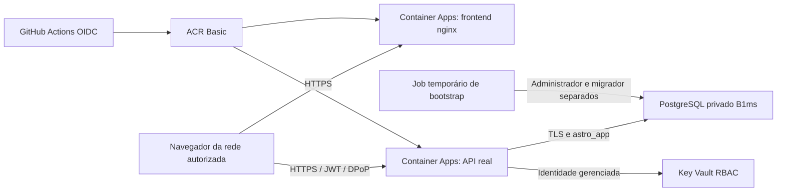

# Azure Students — ambiente econômico de testes

Adaptação autorizada em 12/10/2026. O template original `main.bicep` permanece disponível; a variante está em `infra/azure/students.bicep`.

**Atualização em 14/10/2026:** frontend e API retomados e abertos para qualquer rede a pedido do responsável; ingress sem restrição por IP. Banco continua privado, autenticação/DPoP, CORS e HTTPS preservados. Teste em Microsoft Edge com Playwright: página `/criar-conta` carregou sem erros de JavaScript/rede e `fetch` do próprio navegador para `/biometria/desafios` retornou 201. Isso valida a comunicação inicial do cadastro, não a conclusão da biometria de uma pessoa real. A restrição anterior podia impedir a API de responder para outras redes. Para reproduzir acesso público no provisionamento, usar `Preparar-Students.ps1 -AcessoPublico`; no template runtime, passar `ipsTeste=[]`. Janela atual: 15/10/2026 00:11:08 UTC (14/10 às 21:11:08 em Brasília), com verificação de pausa a cada seis horas.

## Arquitetura e decisões

- Região Canada Central, permitida pela política Students. A VM Standard_B2s consultada estava indisponível para esta assinatura.
- Removidos desta variante Front Door Premium/WAF e Static Web Apps. O primeiro tem custo fixo elevado; o segundo não possui região compatível com a política atual.
- Frontend e API são serviços separados no mesmo ambiente ACA, não três VMs. Banco gerenciado em subnet exclusiva e DNS privado, sem porta pública.
- API: 1 vCPU/2 GiB, mínimo zero e máximo uma réplica, biometria com uma análise concorrente. Frontend: 0,25 vCPU/0,5 GiB, mínimo zero e máximo uma réplica. Há partida a frio.
- HTTPS obrigatório; origem DPoP fixa, CORS exato, filtro de host, cabeçalhos CSP calculados do HTML final, limites de corpo e de requisições. As sondas enviam o host esperado.
- Ingress de ambos os apps aceita inicialmente apenas o IPv4 público do computador usado para provisionar, `/32`. A API continua autenticada. Outras redes e celulares em dados móveis não entram sem acrescentar suas redes autorizadas; uma mudança do IP residencial também exige atualizar a liberação.
- A ausência de WAF gerenciado é uma redução de proteção de borda. Restrição de IP reduz a exposição do teste, mas não torna esse desenho equivalente ao original para produção aberta.
- `AMBIENTE=producao`, facial OpenCV real, modelos com hashes verificados na imagem e sem download em runtime. Depósitos fictícios e documento opcional; não usar dinheiro real.
- Identidades distintas para API, frontend, build, bootstrap e operação. Frontend/build não leem o cofre. API não recebe senha de administrador ou migrador do banco.
- Credenciais são geradas com RNG criptográfico, persistidas localmente com DPAPI em `.azure-local/students-secrets.clixml` e enviadas como parâmetros secure. Essa pasta é ignorada pelo Git. Não compartilhar nem apagar as chaves enquanto existirem dados cifrados.

## Custos e pausa

Orçamento da assinatura: **R$ 10/mês para alertar cedo**, não uma cotação nem teto financeiro. Alertas em R$ 1/5/8/10 e previsão de estouro. Spending limit Students preservado. O saldo de crédito precisa ser conferido no portal; contabilização pode atrasar.

Escala zero não elimina armazenamento PostgreSQL, ACR, DNS, logs e recursos de rede gerenciados pelo ACA. A documentação Microsoft indica custos de IPs públicos/load balancer quando se utiliza uma VNet própria. Não prometer gratuidade ou custo total de R$ 10/mês.

O workflow `Azure Students - iniciar ou pausar testes` é manual e também verifica a janela de testes a cada seis horas. Após o prazo, desativa revisões de frontend/API e para o PostgreSQL, preservando dados. Há atraso possível de agendamento; não é um corte financeiro em tempo real. O banco pode reiniciar automaticamente após sete dias, por isso a verificação continua tentando pausá-lo. Recursos residuais continuam cobrando: para encerrar definitivamente, planejar backup e retirada dos recursos com autorização, incluindo preservação das chaves.

Janela inicial definida até **15/10/2026 19:41:45 UTC**, correspondente a **16:41:45 em Brasília**. A ação manual `retomar` inicia o banco, ativa as revisões e estende a janela por três dias. A ação `pausar` preserva dados. Permissões de operação permitem apenas leitura, edição de tags, ativação/desativação de revisões e start/stop do banco; não permitem exclusão nem leitura dos segredos.

## Publicação e validação

### Correção do cadastro facial — 14/10/2026

**Ajuste posterior de falso negativo:** o classificador passivo era executado também sobre amostras com o rosto virado; uma única recusa dessas amostras bloqueava a sequência. Agora exige dois quadros frontais, ambos aprovados pelo mesmo classificador e limiar. Movimentos continuam conferidos na sequência completa e comparação de identidade continua no início/meio/fim. Não houve redução de limiar nem ativação de stub. 22 testes de lógica passaram, incluindo recusa de frontal falso, ausência de frontal e mudança de identidade. A calibração com pessoas/dispositivos reais ainda precisa de aceite: a alteração reduz uma causa potencial de falsas recusas, mas não comprova que toda câmera será aceita.

O teste inicial do desafio não cobria o processamento do rosto. Os logs de uma tentativa real mostraram `OSError: libEGL.so.1` ao criar o FaceLandmarker no backend. O endpoint `/usuarios/cadastro-sessao` retornava 500; sem CORS nessa resposta, o navegador apresentava `Failed to fetch` e o app mostrava "sem conexão". A restrição de IP era um impedimento potencial para outras redes, mas não resolvia esta falha interna.

Correção: `libegl1`/`libgles2` na imagem de produção e execução real de `landmarks_service.extrair` durante o build, como usuário sem privilégios. A resposta de erro interno também preserva CORS somente para origens autorizadas, com request ID e sem detalhes da exceção. Três testes de regressão verificam origem permitida, origem hostil e domínio com prefixo enganoso.

Validação no Edge contra a imagem corrigida: pedido de cadastro-sessão com DPoP assinado e quadros sem rosto recebeu recusa 401 legível pelo JavaScript, sem erro CORS; nenhuma conta foi criada. Isso valida execução do motor e tratamento da recusa, não substitui o cadastro de uma pessoa real. O bloqueio CSP de `odml.pa.googleapis.com/v1/log` permanece: trata-se de telemetria do SDK, não da API do cadastro.

Infraestrutura base provisionada. Imagens de backend e frontend construídas e enviadas ao ACR por OIDC no GitHub Actions, sem senha de registro persistente. Build confirmado no [run 38299226008](https://github.com/alefkaue/payment-platform/actions/runs/38299226008).

O build Linux apresentou divergência entre localhost IPv4/IPv6 na prerenderização; `preview.host=127.0.0.1` resolveu. Build de produção local e imagem Linux concluíram; a imagem Students remove `async` do módulo do shell antes de recalcular hashes da CSP, preservando a ordem de hidratação.

Testes selecionados: 90 passaram, 11 dependentes de PostgreSQL foram ignorados nesta execução local. O `.env` local foi desabilitado no runner de teste para não contaminar configuração. Esses testes usam biometria stub: não comprovam reconhecimento de uma pessoa real. O build da imagem verifica integridade/leitura dos modelos reais.

**Publicado e verificado:** frontend, `/saude` e `/pronto` responderam HTTP 200 com cabeçalhos de segurança. O bootstrap `astro-bootstrap-yrx3422` concluiu migrações até `f41b26ce0133`, configuração da chave de contexto, restrição de privilégios e `alembic check` sem operações pendentes.

Falhas de implantação corrigidas: o PostgreSQL 16 rejeitou um GRANT redundante de ADMIN OPTION ao próprio grantor; ele foi removido. A versão atual de SQLAlchemy selecionou `psycopg` para URLs `postgresql://`, mas a imagem possui `psycopg2`; URLs de runtime/migração agora especificam `postgresql+psycopg2://`. A URL administrativa usada diretamente por psycopg2 mantém a sintaxe libpq e é convertida explicitamente ao criar o engine SQLAlchemy. O bootstrap inicial foi corrigido em uma execução privada temporária; o código persistente foi atualizado para futuros builds.

Os endereços de teste são:

- Frontend: `https://astro-front.blackwater-4ade2c64.canadacentral.azurecontainerapps.io`
- API: `https://astro-api.blackwater-4ade2c64.canadacentral.azurecontainerapps.io`

Validação HTTP adicional: `/auth/eu` e `/contas/atual` recusaram acesso sem autenticação (401); preflight de uma origem não autorizada foi recusado (400). O job temporário de bootstrap, sua identidade e suas permissões foram removidos após o sucesso, eliminando as credenciais administrativas do job.

Após publicação: conferir página e assets, câmera/CSP, `/saude`, `/pronto`, recusa de chamadas sem autenticação e CORS. A equipe deve concluir cadastro/login facial real, comparação com outra pessoa, transferência persistida, saldo insuficiente e idempotência, em duas contas de teste. Não criar contas biométricas fictícias nem desligar DPoP/facial para passar no aceite.

## Prioridades restantes

- **P0 concluído:** bootstrap, RLS/ACL e sondas HTTP de API/frontend. Confirmação da pausa por execução real permanece pendente; não declarar um teto financeiro garantido.
- **P1:** testar facial no navegador/dispositivos da equipe, confirmar créditos/custos observados e adicionar somente as redes necessárias para os colegas.
- **P1:** definir período real do trabalho e encerramento/backup para evitar cobrança residual prolongada.
- **P2:** consolidar deploy Students com testes do mesmo SHA e migrações separadas para futuras atualizações; o workflow de imagens não atualiza a API automaticamente.
- **P2:** para exposição pública futura, rever WAF, controle distribuído de rate limit e disponibilidade; uma réplica é escolha de economia para testes.

Referências: [rede e recursos gerenciados ACA](https://learn.microsoft.com/en-us/azure/container-apps/custom-virtual-networks), [cobrança ACA](https://learn.microsoft.com/en-us/azure/container-apps/billing), [orçamentos não interrompem consumo](https://learn.microsoft.com/en-us/azure/cost-management-billing/costs/tutorial-acm-create-budgets).
